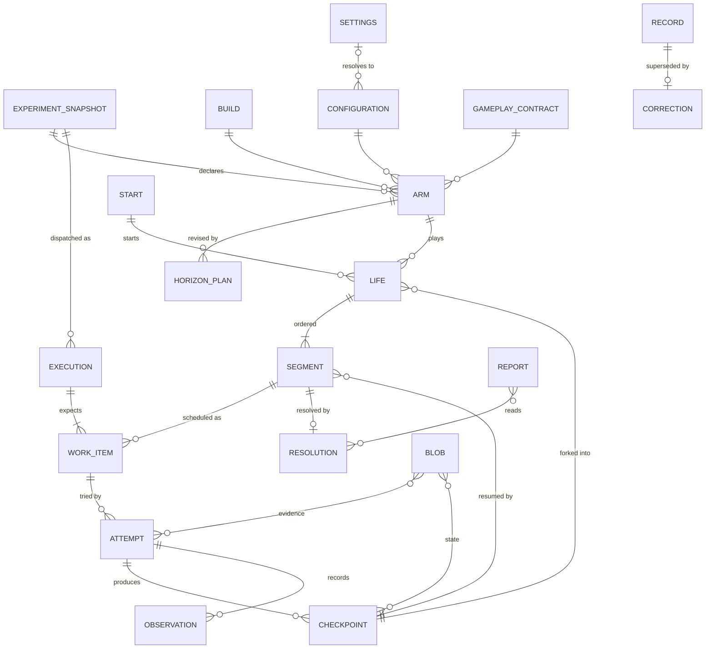

# Architecture of the shared data foundation

Proposal for borg-zoo#114. The [decision page](README.md) explains why this
design was chosen; this page says what it is. Names such as `life` or
`segment` are proposed schema names, not existing code.

## Use cases

| # | Who | Wants to | Needs from the foundation |
| --- | --- | --- | --- |
| U1 | Zoo reader | Compare two versions or configurations on the same seeds | Lives grouped by arm, paired by start, within one execution or with the differences shown |
| U2 | Zoo reader | Inspect what a game was actually configured with | Configuration bytes and effective settings by hash, a readable diff between arms |
| U3 | Zoo operator | Run 1,800 games to 100k, then extend them to 200k and 400k without replaying from birth | Sealed checkpoints, resume claims, segment lineage |
| U4 | Zoo reader | See survival and progress at 100k, 200k and later | Milestones per life, right-censoring, no double counting |
| U5 | Cemetery reader | Browse deaths by seed, race, class, build, cause, depth and evidence available | A case index over lives with a terminal death |
| U6 | Cemetery analyst | Replay a death from the last good checkpoint before it | The last sealed pre-death checkpoint plus a qualified resume method |
| U7 | Cemetery analyst | Try another build or setting from the same position | A fork with its own lineage that never counts as the original life |
| U8 | Anyone | Download a case or an experiment and work offline | A portable bundle: manifest and blobs, each verified by hash |
| U9 | Report author | Publish an analysis that can be traced and rebuilt | Reports as derived records over a hashed set of inputs |
| U10 | Owner | Find out why a run failed, stalled or timed out | Failures kept as first-class outcomes per segment, never turned into deaths |
| U11 | Later tools | Analyse or resume games without knowing the zoo's internals | Published schemas and identity rules, plus the bundle format |

## Entities and identities

Each record is canonical JSON: sorted keys, UTF-8, no insignificant
whitespace, a `schema` field such as `borg-data/life@1`. Its identity is the
SHA-256 of the canonical *identity tuple* named below, not of the whole
record, so a record's identity never depends on fields added later. Hashes
are written `sha256:<hex>`.



| Entity | Identity tuple | Holds |
| --- | --- | --- |
| **Blob** | SHA-256 of the original bytes | Compressed bytes, original size, media type, compression. One blob can serve many records. Stored under a generation-suffixed key ([blob control](#retention-pins-and-deletion)) |
| **Build** | Source repository and full commit, dirty-input digest, harness repository and commit, runner hash, instrumentation version, binary hash, game-data digest, compiler and flags, platform | All build provenance; the build tarball as a blob when kept |
| **Settings** | Adapter kind and the canonical effective settings, defaults included | A semantic equivalence class. Two configurations with the same settings play the same Borg settings, whatever their files look like. There is no settings record when the effective settings are unknown |
| **Configuration** | Adapter kind; the sorted (role, SHA-256) of every original input file (`borg.txt`, the plan file and its plan-contract version, birth options); the settings ID, or `unknown`. A legacy record with neither file bytes nor settings gets `unknown` plus its source attempt's identity, so unrelated unknowns are never merged | The applied inputs: what a game was actually given. Two plan files with the same scalar flags are different configurations. The profile name, the requested profile and how the settings were checked belong to the attempt, not here |
| **Gameplay contract** | Stop boundary (`exact` or `after-key`), calendar policy (real clock or a frozen date), ordinary-play options the runner forces (no cheat death, no respawn), adapter checkpoint state-format version | What must stay equal for a game to continue as the same game. Caps, wall and stall limits are deliberately not part of it |
| **Start** | Engine family, seed as the engine reads it, birth contract (rule, race, class, point buy, birth options) | What makes two lives "the same seed". C and Neo starts never compare equal |
| **Experiment snapshot** | Hash of the experiment file plus every catalogue file it resolves through | The frozen question: arms, suites, endpoints, `prespecified` text |
| **Arm** | Experiment snapshot that created it, build, configuration, gameplay contract | What one column of a comparison means. It has no cap: horizons live in the horizon plan |
| **Horizon plan** | Arm and revision number | Target horizons (for example 100k, then 200k and 400k), endpoints and prespecified text, wall and stall budgets per segment. Extending an arm to a horizon nobody planned is a new revision that names the reason; earlier revisions and their endpoints stay as they were |
| **Execution** | Producer (repository), workflow run ID and run attempt, or a local run ID | The dispatch: its **expected manifest** (the sorted work-item IDs and their hash, closed before any game runs), runner image, date, zoo commit, deployment ID |
| **Work item** | Execution, arm, start, origin (`birth`, or a checkpoint ID, or a cemetery scenario-revision ID), continuation protocol (`from-birth`, `exact`, `fresh-borg`), target horizon, repeat index | One expected piece of play, and an execution's claim on a segment. Several work items can point at one segment; only one holds its claim at a time. Two forks of one game from its 100k and 200k checkpoints in one execution are two work items, and so are two repeats |
| **Life** | Original: arm, start, and the work-item ID of its first segment. Fork: the fork's arm, the parent checkpoint, the continuation protocol, and the fork's first work-item ID | One independent game. Terminal outcome, lineage kind (`original`, `fork`) |
| **Segment** | Life and its starting point (birth, or a checkpoint ID) | The span from that point to the next sealed checkpoint or the end of the game. Its control record is the single place where claims and resolution are decided |
| **Attempt** | Work item, claim generation, deployment ID, job coordinates (execution, shard, job attempt) | Outcome (closing or retryable), wall time, decisions, exit status, evidence blobs, profile name and settings check. Retries are attempts, never new lives |
| **Resolution** | Segment | Write-once record of how the segment closed: the resolving attempt, its record hash and outcome, or `failed` with the last attempt. **The only thing statistics and resume eligibility read** ([protocol](#segment-claims-and-resolution)) |
| **Checkpoint** | Life, cumulative engine turn, producing attempt | Manifest: game save, Borg state, Borg RNG, game RNG, plan/controller state, calendar, build, configuration and gameplay-contract IDs, each file by blob hash. State `sealed` or `fresh-borg-only` |
| **Observation** | Attempt, cumulative turn, kind | Milestones (level, depth, gold, later net worth) at fixed turns, depth marks, stall blocks |
| **Report** | Analysis name and version, hash of the sorted input set, endpoint definitions | The input set lists segment resolutions and the corrections applied, each with its hash. The output is a blob. A report is never an input to statistics |
| **Correction** | The corrected record's ID and a correction ordinal | `supersedes`, reason, author, the replacement record |

Cemetery entities sit on top and point down: an *episode* names a life, an
attempt and a turn range; a *scenario revision* names a checkpoint and its
continuation mode; a cemetery *source attempt* is a foundation attempt ID.
That fixes PR #2's finding R4 (source identity collisions) by construction,
because the execution and attempt coordinates are already in the attempt's
identity. A cemetery trial of another build from a scenario is a work item
whose origin is that scenario revision.

### Mapping from today's records

| Today | Becomes |
| --- | --- |
| `results/<experiment>/<run>/meta.json` | Experiment snapshot, execution, and one horizon plan per arm with the suite's cap |
| One `cells.jsonl` line | A work item, a life, its segment from birth, one attempt and a resolution (`imported`); observations from `milestones`, `first_turn_at_depth`, `stall`; evidence hashes become blob references (bytes missing unless salvaged) |
| `specimen`, `specimen_ref`, `binary_sha256`, `runner_sha256`, `harness_commit`, `compiler` | Build |
| `config_sha256` and `effective_settings` | Configuration and settings. A missing `config_sha256` gives an `unknown` configuration tied to that attempt, never a guessed one |
| `profile`, `profile_sha256`, `profile_applied` | Attempt fields |
| `boundary`, `calendar` | Gameplay contract (boundary), attempt (calendar observed) |
| `suite`, `seed`, `birth`, `race`, `class` | Start |
| `outcome`, `cause`, `final`, `wall_seconds` | The attempt's outcome; also the life's terminal outcome when the life has one segment |

## Invariants

Each invariant gets a test in the milestone that implements it
([PLAN.md](PLAN.md)). The failure sequences from both reviews of
[PR #119](https://github.com/diegoami/borg-zoo/pull/119) are among those
tests.

1. **Append-only.** No ledger object is ever overwritten or deleted by
   normal operation. Blobs are deleted only by the retention protocol below.
   Corrections are new records that name what they supersede; readers show
   the correction chain, and the original stays retrievable.
2. **Write-once identity.** A batch, commit marker, checkpoint, resolution
   or export root is written by create-if-absent. Identical bytes are a
   no-op; different bytes are a conflict that stops the job. Records inside
   different batches can still claim one identity with different payloads
   (two publishers, a bug). The index detects this, keeps both, marks the
   identity `conflicted`, and uses neither in statistics until a correction
   resolves it. Nothing is replaced.
3. **Every expected work item is accounted for.** The expected manifest is
   closed before play. Each work item ends as an attempt, a `not_received`
   attempt written by finalisation, or `skipped` because its segment was
   already claimed or closed by another execution (a scheduling note, not an
   attempt). `not_received` is a harness failure, never a death and never
   dropped. A real result that arrives after its claim has moved on is
   stored as `late` and counts only through a correction.
4. **One life, one count.** Statistics count lives, never segments,
   attempts, checkpoints, work items or forks. A resumed segment extends its
   life. A fork is a new life with `lineage: fork` and is excluded from the
   parent arm's statistics.
5. **One resolution per segment.** A segment has one control record and
   at most one write-once resolution ([protocol](#segment-claims-and-resolution)).
   Statistics and resume eligibility read resolutions, never claims. Every
   attempt, failed or not, stays visible with its evidence.
6. **A checkpoint is usable only when sealed.** Sealing requires every blob
   in its manifest to be stored, owned by the checkpoint through the blob
   protocol, and its hash verified on read-back. Resume refuses anything
   else.
7. **Resume is refused when incompatible.** Build, configuration, gameplay
   contract and adapter state-format version must equal the checkpoint's.
   Anything else is a fork with its own arm. **Horizons and budgets are not
   compatibility conditions:** extending an arm to a later horizon is a new
   horizon-plan revision of the same arm, and its lives continue.
8. **Turns are cumulative.** Engine turns count from birth across segments.
   Segment-local decisions, wall time and Borg restarts are separate fields.
9. **Survival is right-censored.** "Alive at H" needs resolved segments
   covering birth to at least H with no death before it. A life whose
   resolved segments stop short of H is `not_reached` at H, not alive and
   not dead.
10. **Failures stay failures.** Stalls, wall timeouts, crashes, harness
    failures, configuration errors and lost workers are outcomes of
    attempts and are reported per arm. A failure is retried only within the
    horizon plan's declared retry budget (decision D8). A life whose segment
    is open after failures, or closed as failed, is `incomplete` at later
    horizons, and its failures are shown.
11. **Unknown stays unknown.** Missing provenance, settings or evidence is
    stored as `unknown` or `unavailable` with a reason. Imported records are
    labelled `imported` with their evidence level, and nothing is
    reconstructed by guessing.
12. **Derived data is rebuildable.** The index, the site, report caches and
    bundles can all be deleted and rebuilt from the ledger and blobs.
13. **Execution conditions are recorded.** Calendar, runner image and
    compiler belong to every attempt. Comparing arms across executions
    shows these differences, as zoo rule 7 requires today.
14. **References and deletion are ordered.** A blob reference or pin names
    its owner and either lands before the blob is marked for deletion, and
    then prevents it, or fails visibly. A reference whose owner never
    commits is released by reconciliation. A deleted generation is never
    reused.
15. **Stale writers are excluded.** Each deployment (bucket and its write
    credentials) has its own ID, carried by every claim and attempt. A
    restore creates a new deployment after revoking the old credentials, so
    no writer from before the restore can write into it.

## Storage layout

One S3-compatible bucket per deployment, with prefixes having different
rules:

```text
blobs/sha256/<2 hex>/<64 hex>/g<N>.<zst|gz|raw>  one key per generation, never reused
ledger/<kind>/<execution-id>/<batch>.jsonl.gz     write-once record batches
ledger/<kind>/<execution-id>/<batch>.commit       write-once commit marker, written last
ledger/checkpoints/<checkpoint-id>.json           write-once, written when sealed
ledger/resolutions/<segment-id>.json              write-once segment resolutions
control/deployment.json                           write-once deployment ID
control/segments/<segment-id>.json                conditional replace, one per segment
control/blobs/<hash>.json                         conditional replace, one per blob
index/<generation>/zoo.sqlite.gz, *.parquet       derived, replaceable
site/                                             derived static site
```

Exports go to a second location ([Backup](#backup-and-restore)).

- Records are batched per (execution, shard, attempt), so one file holds
  hundreds to thousands of records and compresses about 12× (measured).
- A batch is visible only once its `.commit` object exists. The commit
  lists the batch hash, record count and every blob it references. Readers
  ignore batches without a commit marker.
- Blobs are compressed with zstd or gzip (settled in the M2 benchmark).
  Identity is the hash of the original bytes; the index maps each hash to
  its live key.
- Git holds code, catalogue, schemas, the frozen legacy `results` branch and
  small reviewed fixtures. It no longer holds new results.

## Protocols

All protocols rely on two storage operations: **create-if-absent** and
**replace-if-unchanged** (an ETag or generation precondition). Amazon S3
(`If-None-Match`, `If-Match`), Google Cloud Storage (generation
preconditions) and Cloudflare R2 document both. No provider has been
conformance-tested yet (tasks T1, T3). There is no transaction across two
objects, so each decision below has a single conditional write as its
commit point, on the one object that owns that decision. A local filesystem
backend implements the same two operations (`O_EXCL` create, rename under a
lock) for tests and offline use.

### Actors and permissions

| Actor | Runs | Can write |
| --- | --- | --- |
| **Runner jobs** | Borg code, including candidate code from other projects | Nothing in the bucket. They return results as Actions artifacts |
| **Coordinator jobs**: `plan`/`dispatch`, `publish`/`finalize`, `reconcile` | Zoo code only | `blobs/`, `ledger/`, `control/`; no delete permission |
| **Index job** | Zoo code only, one concurrency group | `index/`, `site/` |
| **Retention job** | Zoo code only, dry-run by default | Deletes blob generations, through the blob protocol |
| **Export job** | Zoo code only | Reads the bucket; writes only to the export location |

All claiming, resolution and pinning happen in coordinator jobs, never in
runner jobs.

### Ingesting a zoo execution

1. **plan** writes the execution record with its closed expected manifest,
   create-if-absent, so a re-run of the same workflow attempt is a no-op. It
   then claims each work item's segment ([below](#segment-claims-and-resolution));
   work items whose segment is already claimed or closed are `skipped`.
2. **Runner jobs** play their games and flush each finished game to local
   JSONL immediately (zoo rule 13). They upload batches and evidence as
   artifacts even when cancelled.
3. **publish**, for each runner artifact: uploads blobs and registers the
   batch as their owner through the [blob protocol](#retention-pins-and-deletion),
   writes the batch, then its commit marker, then resolves each attempt's
   segment. Publishing the same artifact twice is a no-op. A publish that
   dies midway leaves pending blob owners that reconciliation releases.
4. **finalize** writes a `not_received` attempt for each claim this
   execution still holds without a published attempt, and applies it to the
   segment like any other failure. It then marks the execution closed.
5. **index** reads resolutions and commit markers newer than its last
   generation, writes a new generation and builds the site from it. It is
   rebuildable from scratch.

Batches and commit markers of different executions have disjoint keys.
Executions that touch the same segment meet only at that segment's control
record, where one conditional write decides.

### Segment claims and resolution

```text
control/segments/<segment-id>.json
  {state: open|claimed|closed, generation, deployment, holder, work_item,
   deadline, failures, resolution?}
```

A segment is the unit of claiming and resolution. Work items are the
executions' bookkeeping: several work items, from different executions, can
point at one segment, but only the holder of the segment's current claim
can resolve it.

**Outcomes.** Each attempt's outcome either **closes** the segment or is
**retryable**:

| Closes the segment | Retryable, within the horizon plan's retry budget |
| --- | --- |
| Death, completion; reached the target (with a sealed checkpoint when the horizon plan continues past it); stalled, `borg_stopped`, decision cap; configuration error | Harness failure, `not_received`, lost worker (claim taken over), wall timeout, crash; reached a target that needs a checkpoint, but the checkpoint failed to seal |

Play from a checkpoint is deterministic, so a retry can finish a game but
cannot pick a different game outcome. A deterministic crash recurs and uses
up the budget. Ordinary experiments have a budget of **0**: one attempt,
and a failure stands, as the zoo does today. Long-run arms have a budget of
**2**, declared in the horizon plan before the run (decision D8).

1. **Claim.** A coordinator creates the control record (create-if-absent)
   or replaces an `open` one (replace-if-unchanged) with
   `state = claimed`, `generation + 1`, the deployment ID, the holder
   (workflow run, job attempt, shard), its work item and a deadline equal
   to the runner job's timeout plus a margin. Runner jobs cannot outlive
   their timeout, so no renewal is needed. A `claimed` or `closed` segment
   is not claimed again: that work item is `skipped`.
2. **Takeover.** A `claimed` segment whose deadline has passed **and**
   whose holder job GitHub reports finished can be replaced with a new
   claim (`generation + 1`). This counts as a lost-worker failure against
   the budget. A `closed` segment is never taken over.
3. **Commit point.** After an attempt's batch is committed, publish reads
   the control record and replaces it, conditional on that read's ETag and
   only if the record is `claimed` with the attempt's generation and
   deployment:
   - a **closing** outcome: `closed(generation, resolution: attempt ID,
     record hash, outcome)`;
   - a **retryable** outcome within budget: `open(generation, failures + 1)`;
   - a retryable outcome with the budget used up:
     `closed(generation, resolution: failed, the last attempt)`.

   An **expired but uncontested** claim still resolves: the deadline only
   permits takeover, and game results do not depend on the claim clock.
   If the ETag no longer matches (a takeover, or finalisation), the
   attempt is recorded `superseded` or `late`, with its evidence.
4. **Resolution record.** Once the segment is `closed`, publish writes
   `ledger/resolutions/<segment-id>.json` create-if-absent with the same
   content as the record's `resolution`. If it crashes first, any later
   publish or the `reconcile` job finds a `closed` record without a
   resolution and writes it. Re-writing an identical resolution is a no-op.
5. When a segment closes as "reached the target with a sealed checkpoint",
   the life's next segment (from that checkpoint) can be claimed.

Two executions resuming the same checkpoint meet at one control record:
the first claim wins and the other's work item is `skipped`. Clock skew
cannot create two holders, because a takeover also needs the holder's job
to be finished according to GitHub. No sequence creates a second life.

### Publishing a checkpoint

1. The runner stops play at a command boundary at or after the target turn
   and writes the save, Borg state and RNG state *without* advancing the
   game ([RESUME.md](RESUME.md)).
2. Publish uploads each file through the blob protocol with the checkpoint
   as their owner, and verifies each hash by reading it back.
3. It writes `ledger/checkpoints/<id>.json` create-if-absent, listing every
   blob, the state-format version, and the build, configuration and
   gameplay-contract IDs. This is the owner's commit.
4. A checkpoint missing required state, for example Borg memory on an
   adapter that cannot save it, is written as `fresh-borg-only`. Resume
   refuses it as an exact continuation; a fork can start from it, labelled
   as one.

### Retention, pins and deletion

Every blob has a control record, created when it is first uploaded:

```text
control/blobs/<hash>.json
  {state: staged|live|deleting|deleted, generation, forever,
   owners: {owner-id: pending|committed}, pins, staged_at}
```

Owner IDs are deterministic: a batch ID, a checkpoint ID, a pin ID or an
export root ID. Registering the same owner twice is a no-op.

- **Upload:** create the record as `staged` (or, if it is `deleted`, move it
  to `staged` with `generation + 1`), then upload to that generation's key.
- **Register an owner:** replace-if-unchanged to `live`, adding the owner as
  `pending`. Only then is the owner committed (batch commit marker,
  checkpoint record, pin record, export root). Afterwards the owner is
  marked `committed`, by the same publish or later by `reconcile`. If the
  record is `deleting`, registration fails visibly; the caller re-uploads
  once it is `deleted`, or reports the evidence as unavailable.
- **Reconcile:** for a `pending` owner older than the grace period, if the
  owner's commit object exists, mark it `committed`; otherwise remove it. A
  blob left with no owners and no pins is an orphan.
- **Forever classes:** once a blob of a class kept forever has one
  committed owner, its record is marked `forever` and stops listing
  further owners. It is never selected for deletion.
- **Delete:** the retention job may replace the record with `deleting`,
  conditional on the version it read, only when it has no `pending` owners,
  no pins, and every committed owner's retention has expired, or when it is
  an orphan past the grace period. That conditional write is the commit
  point: a registration or pin that changed the record first makes it fail,
  and any later one fails on `deleting`. The job then deletes exactly that
  generation's key, moves the record to `deleted`, and writes a deletion
  receipt to the ledger. Generation keys are never reused.

Pins are ledger records (`pin {object, owner, reason}`) and unpins are
corrections, so retention decisions are auditable.

| Class | Default | Notes |
| --- | --- | --- |
| Ledger records, commit markers, resolutions, corrections | Forever | Small: about 285 bytes per game, compressed |
| Configuration bytes, build manifests | Forever | Deduplicated by hash |
| Sealed checkpoints of lives in an active long-run arm | Until the arm is closed, then the last two per life | Owner can pin more |
| Last sealed checkpoint before a death, and the terminal save | Forever (cemetery) | The basis of U6 |
| Raw logs and traces of deaths, stalls and failures | Forever, compressed | About 190 KB per game measured; 38% of games today |
| Raw logs and traces of survivors | 90 days, unless pinned | Same as today's artifact retention |
| Build tarballs | Until no sealed checkpoint references the build, then 90 days | A checkpoint without its build cannot be resumed |
| Orphans (no owner, no pin) | 7 days | Swept |
| Index generations, site, report caches | Last 3 generations | Rebuildable |

### Corrections

A correction is a ledger record `{supersedes: <record id>, reason, by,
replacement}`. The index applies the latest correction when computing
statistics and shows the chain on the record's page. Correcting a correction
is allowed; deleting one is not.

### Reports

A report job takes an explicit input set (an execution, an arm, a list of
lives), resolves it to segment resolutions and the corrections in force,
writes those IDs and hashes with the analysis name and version and the
endpoint definitions, then stores the output as a blob. The same inputs and
version produce the same report identity. A report built from records that
were later corrected says so.

## Access and security

- **Public read** of `blobs/`, committed `ledger/`, `index/` and `site/`
  (decision D6).
- **Writes** follow the [actors table](#actors-and-permissions), with a
  repository secret or, where the vendor supports it, GitHub OIDC
  federation. GitHub documents OIDC for AWS and Google Cloud; other
  S3-compatible vendors need a scoped secret (T1). Each deployment has its
  own write credentials.
- **Jobs that run Borg code get no credentials.** This also covers
  candidate code supplied by other projects.

## Backup and restore

- The bucket's object versioning or retention lock, where the vendor offers
  one, protects against a misused token.
- **Export roots.** A monthly export job builds a frozen, dependency-closed
  root and copies it to a second location:
  1. List the resolutions. For each, follow its dependencies by direct key
     lookup, not by listing: the segment's starting checkpoint, the attempt
     that produced it, and that attempt's segment resolution, back to birth.
     A child segment can only be claimed after its parent's resolution
     exists, so the lookup always finds the parent, even one written after
     the listing passed its key.
  2. Add the batches and commit markers of every included attempt, the
     checkpoint records, and the corrections that target included records.
     A correction made during the export may be missed. The root is then
     consistent as of a slightly earlier state, but never includes a
     correction without its target.
  3. Register the root as owner of every blob generation it references, so
     retention keeps them for the root's lifetime, and copy them.
  4. Verify closure: every reference inside the root resolves inside the
     root, and every copied blob's hash matches. Only then write the root
     manifest, create-if-absent, which makes it restorable.

  Claims and blob control records are not exported. Closed segments are
  reconstructible from resolutions; open and claimed ones restart as open.
- **Restore** always creates a new deployment; there is no in-place
  restore. Its linearization point is revoking the old deployment's write
  credentials and confirming that a write with them fails. Old
  coordinators, publishers paused before a commit point, and dispatchers
  paused before a claim can then no longer write anything. If the old
  bucket is still readable, take one more export root from it after
  revocation, so that nothing resolved before the cutoff is lost. Then
  restore the root into a new bucket with new credentials and a new
  `control/deployment.json`. Rebuild segment records from resolutions
  (closed) and from attempts (open, with their failure counts), and the
  index from the ledger, then resume dispatch. Runner artifacts from
  the old deployment carry its ID; the new publish refuses them and records
  them as `stale`, importable only through a correction.
- **Restore drill** (M2 acceptance):
  - Restore a root into an empty bucket and compare the statistics and
    horizon coverage with the live index.
  - Pause a publisher just before its commit point, another just before
    writing a resolution, and a dispatcher just before a claim; restore;
    show that none of them can write into the new deployment.
  - During an export, write a parent resolution behind the listing cursor
    and its child ahead of it, and show that the root contains both.
  - Show that a checkpoint whose blob was removed is reported
    `unavailable`, never resumable.

## Cost estimate

Volumes from the [baseline](README.md#measured-baseline-2026-11-15),
projected to a year at about the current pace (2 to 3 million games). These
are list prices as published for 2025–26. Check them again before choosing a
vendor (task T1).

| Item | Year-one volume |
| --- | --- |
| Ledger | 0.6–0.9 GB compressed |
| Raw evidence | Evidence-retaining runs produced 4.75 GiB in nine days (about 190 KB per game). Deaths are 32% of games and failures, stalls and timeouts 6%, so keeping those forever and survivors for 90 days is about 75–100 GB in year one |
| Checkpoints | Per long-run arm, 1,800 lives × 4 checkpoints × 0.1–1 MB = 0.7–7 GB (Borg-state size unknown, see [RESUME.md](RESUME.md)) |
| Writes | About 1 batch per 1,000 games; per game a segment claim, its closing update and a resolution (3 writes, so 6–9 million a year: roughly $25–40 a year at R2's listed $4.50 per million after the free tier); per retained blob about 4 (control record, upload, owner registration, owner commit) |
| Reads | Index and site files, served as static objects |

| Option | Rough monthly cost at about 100 GB |
| --- | --- |
| Cloudflare R2 | 10 GB free, then $0.015/GB-month, no egress charge: about $1–2 for storage, plus $2–4 a month for the per-game writes above |
| Backblaze B2 | $6.95/TB-month (listed 2026-11-15), free egress up to 3× stored: under $1 |
| Google Cloud Storage or Amazon S3 | About $0.02/GB-month plus internet egress at roughly $0.09–0.12/GB: $1–2 storage, more if large downloads are popular |
| Firestore (option C) | Free tier of 50k reads and 20k writes a day. A 9,000-game experiment written as one document per game uses about half the daily writes; with segments, attempts and observations as their own documents it exceeds them. Beyond the free tier writes cost about $0.18 per 100k; with three or more documents per game that is roughly $5–20 a year. Live dashboard reads cost per document read, so views must be precomputed. Storage needs the Blaze plan |
| Managed PostgreSQL (option D) | Free tiers hold about 0.5 GB and some suspend when idle; paid plans start around $5–25 a month |

Every option is cheap at this volume. Operational effort and fit with the
invariants matter more.
