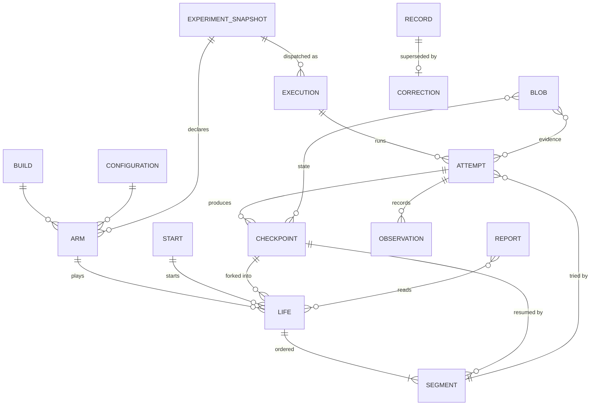

# Architecture of the shared data foundation

Proposal for borg-zoo#114. The [decision page](README.md) explains why this
design was chosen; this page says what it is. Names such as `life` or
`segment` are proposed schema names, not existing code.

## Use cases

| # | Who | Wants to | Needs from the foundation |
| --- | --- | --- | --- |
| U1 | Zoo reader | Compare two versions or configurations on the same seeds | Lives grouped by arm, paired by start, within one execution or with the differences shown |
| U2 | Zoo reader | Inspect what a game was actually configured with | Configuration bytes and effective settings by hash, a readable diff between arms |
| U3 | Zoo operator | Run 1,800 games to 100k, then extend them to 200k and 400k without replaying from birth | Sealed checkpoints, resume claims, segment lineage |
| U4 | Zoo reader | See survival and progress at 100k, 200k and later | Milestones per life, right-censoring, no double counting |
| U5 | Cemetery reader | Browse deaths by seed, race, class, build, cause, depth and evidence available | A case index over lives with a terminal death |
| U6 | Cemetery analyst | Replay a death from the last good checkpoint before it | The last sealed pre-death checkpoint plus a qualified resume method |
| U7 | Cemetery analyst | Try another build or setting from the same position | A fork with its own lineage that never counts as the original life |
| U8 | Anyone | Download a case or an experiment and work offline | A portable bundle: manifest and blobs, each verified by hash |
| U9 | Report author | Publish an analysis that can be traced and rebuilt | Reports as derived records over a hashed set of inputs |
| U10 | Owner | Find out why a run failed, stalled or timed out | Failures kept as first-class outcomes per segment, never turned into deaths |
| U11 | Later tools | Analyse or resume games without knowing the zoo's internals | Published schemas and identity rules, plus the bundle format |

## Entities and identities

Each record is canonical JSON: sorted keys, UTF-8, no insignificant
whitespace, a `schema` field such as `borg-data/life@1`. Its identity is the
SHA-256 of the canonical *identity tuple* named below, not of the whole
record, so a record's identity never depends on fields added later. Hashes
are written `sha256:<hex>`.



| Entity | Identity tuple | Holds |
| --- | --- | --- |
| **Blob** | SHA-256 of the original bytes | Compressed bytes in the bucket, original size, media type, compression. One blob can serve many records |
| **Build** | Source repository and full commit, dirty-input digest, harness repository and commit, runner hash, instrumentation version, binary hash, game-data digest, compiler and flags, platform | All build provenance; the build tarball as a blob when kept |
| **Configuration** | Adapter kind and canonical effective settings, including defaults | Original bytes of each input file as blobs (`borg.txt`, `errands_plan.txt`, birth options), their hashes, the requested profile name, how the effective settings were checked. Two profiles that resolve to the same effective settings share one configuration but keep their own byte hashes |
| **Start** | Engine family, seed as the engine reads it, birth contract (rule, race, class, point buy, birth options), calendar policy | What makes two lives "the same seed". C and Neo starts never compare equal |
| **Experiment snapshot** | Hash of the experiment file plus every catalogue file it resolves through | The frozen question: arms, suites, endpoints, `prespecified` text |
| **Arm** | Experiment snapshot, build, configuration, execution contract (caps, wall and stall limits, boundary, frozen calendar or not) | What one column of a comparison means |
| **Execution** | Producer (repository), workflow run ID and run attempt, or a local run ID | The dispatch: which arms and starts were *expected*, runner image, date, zoo commit |
| **Life** | Arm, start, lineage root (the execution and expected-cell key of its first segment) | One independent game. Terminal outcome, lineage kind (`original`, `fork`), parent checkpoint for a fork |
| **Segment** | Life, ordinal (0 = from birth), the checkpoint it starts from | Target cumulative turn, the accepted attempt |
| **Attempt** | Segment, execution, shard, job attempt, fencing token | Segment-local outcome, wall time, decisions, exit status, evidence blobs. Retries are attempts, never new lives |
| **Checkpoint** | Life, cumulative engine turn, producing attempt | Manifest: game save, Borg state, Borg RNG, game RNG, plan/controller state, calendar, build and configuration IDs, each by blob hash. A state: `staged`, `sealed`, `retired` |
| **Observation** | Attempt, cumulative turn, kind | Milestones (level, depth, gold, later net worth) at fixed turns, depth marks, stall blocks |
| **Report** | Analysis name and version, hash of the sorted input set (life and attempt IDs with their record hashes), endpoint definitions | The output bytes as a blob. A report reads lives; it is never an input to statistics |
| **Correction** | The corrected record's ID and a correction ordinal | `supersedes`, reason, author, the replacement record |

Cemetery entities sit on top and point down: an *episode* names a life, an
attempt and a turn range; a *scenario revision* names a checkpoint and its
continuation mode; a cemetery *source attempt* is a foundation attempt ID.
That fixes PR #2's finding R4 (source identity collisions) by construction,
because the execution and attempt coordinates are already in the attempt's
identity.

### Mapping from today's records

| Today | Becomes |
| --- | --- |
| `results/<experiment>/<run>/meta.json` | Experiment snapshot plus execution |
| One `cells.jsonl` line | A life, its segment 0 and one attempt; observations from `milestones`, `first_turn_at_depth`, `stall`; evidence hashes become blob references (bytes missing unless salvaged) |
| `specimen`, `specimen_ref`, `binary_sha256`, `runner_sha256`, `harness_commit`, `compiler` | Build |
| `profile`, `profile_sha256`, `config_sha256`, `effective_settings` | Configuration; a missing `config_sha256` is recorded as `unknown`, never guessed |
| `suite`, `seed`, `birth`, `race`, `class`, `calendar` | Start |
| `outcome`, `cause`, `final`, `wall_seconds` | The attempt's outcome; it is also the life's terminal outcome when the life has one segment |

## Invariants

Each invariant gets a test in the milestone that implements it
([PLAN.md](PLAN.md)).

1. **Append-only.** No ledger object or blob is ever overwritten or deleted
   by normal operation. Corrections are new records that name what they
   supersede; readers show the correction chain, and the original stays
   retrievable.
2. **Write-once identity.** Writing an existing identity with identical
   bytes is a no-op. With different bytes it is a conflict that stops the
   job and is reported; nothing is replaced.
3. **Every expected game is accounted for.** An execution lists its expected
   (arm, start) pairs before any game runs. Finalising it writes an explicit
   `not_received` attempt for each pair without a result. That is a harness
   failure, never a death and never dropped.
4. **One life, one count.** Statistics count lives, never segments,
   attempts, checkpoints or forks. A resumed segment extends its life. A
   fork is a new life with `lineage: fork`, and it is excluded from the
   parent arm's statistics.
5. **One accepted attempt per segment.** The accepted attempt is the one
   that finished while holding the segment's current lease. Other attempts
   stay visible as `superseded` or `failed`, with their evidence.
6. **A checkpoint is usable only when sealed.** Sealing requires every blob
   named in its manifest to be stored and its hash verified on read-back.
   Resume refuses `staged` checkpoints.
7. **Resume is refused when incompatible.** The build, configuration,
   execution contract and adapter state-format version must equal the
   checkpoint's. Anything else is a fork with its own arm. A different
   build, plan or setting can never silently continue a life.
8. **Turns are cumulative.** Engine turns count from birth across segments.
   Segment-local decisions, wall time and Borg restarts are separate fields.
9. **Survival is right-censored.** "Alive at H" needs accepted segments
   covering birth to at least H with no death before it. A life whose
   segments stop short of H is `not_reached` at H, not alive and not dead.
10. **Failures stay failures.** Stalls, wall timeouts, crashes, harness
    failures, configuration errors and lost workers are outcomes of the
    attempt. A life with a failed last segment is `incomplete` at later
    horizons, and the failure is shown.
11. **Unknown stays unknown.** Missing provenance, settings or evidence is
    stored as `unknown` or `unavailable` with a reason. Imported records are
    labelled `imported` with their evidence level, and nothing is
    reconstructed by guessing.
12. **Derived data is rebuildable.** The index, the site, report caches and
    bundles can all be deleted and rebuilt from the ledger and blobs.
13. **Execution conditions are recorded.** Calendar, runner image and
    compiler belong to every attempt. Comparing arms across executions
    shows these differences, as zoo rule 7 requires today.

## Storage layout

One S3-compatible bucket, with prefixes having different rules:

```text
blobs/sha256/<2 hex>/<64 hex>.<zst|gz|raw>   write-once, public read
ledger/<kind>/<execution-id>/<batch>.jsonl.gz write-once record batches
ledger/<kind>/<execution-id>/<batch>.commit   write-once commit marker, written last
control/leases/<segment-id>.json              conditional replace, the only mutable prefix
index/<generation>/zoo.sqlite.gz, *.parquet   derived, replaceable
site/                                         derived static site
exports/<date>/                               portable snapshots (see Backup)
```

- Records are batched per (execution, shard, attempt), so one file holds
  hundreds to thousands of records and compresses about 12× (measured).
- A batch is visible only once its `.commit` object exists. The commit
  lists the batch hash, record count and every blob hash it references.
  Readers ignore batches without a commit marker.
- Blobs are compressed with zstd or gzip (to be settled in the M2
  benchmark); the key is the hash of the original bytes, so compression can
  change without changing identity.
- Git holds code, catalogue, schemas, the frozen legacy `results` branch and
  small reviewed fixtures. It no longer holds new results.

## Protocols

All protocols rely on two storage operations: **create-if-absent** and
**replace-if-unchanged** (an ETag or generation precondition). Amazon S3
(`If-None-Match`, `If-Match`) and Google Cloud Storage (generation
preconditions) document both. Cloudflare R2 and Backblaze B2 must be checked.
Confirm the exact semantics for the chosen vendor before relying on them
(task T1). A local
filesystem backend implements the same two operations (`O_EXCL` create,
rename under a lock) for tests and offline use.

### Ingesting a zoo execution

1. **plan** writes the execution record: expected (arm, start) pairs, the
   experiment snapshot hash and the runner image. It is create-if-absent, so
   a re-run of the same workflow attempt is a no-op.
2. **run** shards play their games and flush each finished game to local
   JSONL immediately (zoo rule 13). They upload shard batches and evidence
   as artifacts even when cancelled. **Run jobs hold no storage
   credentials**: they execute Borg code.
3. **publish** is a trusted job with a write token scoped to `blobs/` and
   `ledger/`. For each shard artifact it uploads blobs (create-if-absent; if
   one exists, its stored hash must match), then the batch, then its commit
   marker. Publishing the same artifact twice is a no-op. A job that dies
   midway leaves blobs without a commit, which the orphan sweep removes after
   a grace period. It never leaves a half-visible batch.
4. **finalize** compares expected pairs with committed attempts and writes
   `not_received` attempts for the gaps (invariant 3).
5. **index** runs in a single concurrency group. It reads commit markers
   newer than the last index generation, adds them to the SQLite/Parquet
   index, writes a new generation and builds the site from it. It is
   rebuildable from scratch.

Collectors of different executions write disjoint keys, so they do not race.
Only the index step is serialised, and losing that race only delays a
rebuild.

### Publishing a checkpoint

1. The runner stops play at a command boundary at or after the target turn
   and writes the save, Borg state and RNG state *without* advancing the
   game (see [RESUME.md](RESUME.md) for how each adapter does this).
2. The trusted publish step uploads each file as a blob and reads its hash
   back.
3. It writes `checkpoint` with state `sealed`, create-if-absent under the
   checkpoint's identity. The manifest lists every blob, the adapter's
   state-format version, and the build, configuration and execution contract
   IDs.
4. A checkpoint missing any required state, for example Borg memory on an
   adapter that cannot save it, is sealed with `continuation: fresh-borg-only`.
   Resume refuses to use it as an exact continuation; a fork can still
   start from it, labelled as one.

### Resuming a segment

```text
lease = control/leases/<segment-id>.json
  {holder, token, expires_at, checkpoint_id}
```

1. A resume execution lists the segments to extend: life, from-checkpoint,
   target turn.
2. A worker claims a segment by **create-if-absent** on its lease, with
   `token = 1`. If the lease exists and has expired, it takes it over by
   **replace-if-unchanged** on the ETag it read, with `token + 1`. If the
   lease is live, it skips the segment.
3. The worker renews the lease by replace-if-unchanged, well before it
   expires. A failed renewal means the worker has lost the segment: it stops
   and uploads what it has, as a superseded attempt.
4. Results go to the ledger under an attempt identity that includes the
   token. The index accepts only the attempt whose token equals the lease's
   final token (invariant 5). A late worker with an old token can write, but
   its attempt is recorded as `superseded`, never accepted.
5. When the accepted attempt has a sealed checkpoint at the target turn,
   the next segment becomes eligible. Leases of finished segments are
   marked `done`; they are kept as evidence, not deleted.

Worker loss is just lease expiry. Retrying a crash is a new attempt on the
same segment. Neither creates a life.

### Corrections

A correction is a ledger record `{supersedes: <record id>, reason, by,
replacement}`. The index applies the latest correction when computing
statistics and shows the chain on the record's page. Correcting a correction
is allowed; deleting one is not.

### Reports

A report job takes an explicit input set (an execution, an arm, a list of
lives), writes its sorted input IDs and record hashes, the analysis name and
version, and the endpoint definitions, then stores the output as a blob. The
same inputs and version produce the same report identity, so a cached report
can be reused. A report built from superseded records says so.

## Access and security

- **Public read** of `blobs/`, committed `ledger/`, `index/` and `site/`.
  The zoo and the cemetery are public repositories whose results are already
  public. If any blob class must stay private, that is owner decision D6 in
  the [plan](PLAN.md).
- **Writes** only from the trusted publish, finalize and index jobs, with a
  repository secret or, where the vendor supports it, GitHub OIDC
  federation, so no long-lived key is needed. Tokens are scoped by prefix.
  No token can delete.
- **Jobs that run Borg code get no credentials.** Resume workers download
  checkpoints by public URL and return results as artifacts for the trusted
  job to publish, as today's run/collect split does. This also covers
  candidate code supplied by other projects.
- **Deletion** (retention expiry, orphan sweep) is a separate job with its
  own token. It is dry-run by default and writes a deletion receipt for each
  object it removes.

## Retention

| Class | Default | Notes |
| --- | --- | --- |
| Ledger records, commit markers, corrections | Forever | Small: about 285 bytes per game, compressed |
| Configuration bytes, build manifests | Forever | Deduplicated by hash |
| Sealed checkpoints of lives in an active long-run arm | Until the arm is closed, then the last two per life | Owner can pin more |
| Last sealed checkpoint before a death, and the terminal save | Forever (cemetery) | The basis of U6 |
| Raw logs and traces of deaths, stalls and failures | Forever, compressed | About 190 KB per game measured; 38% of games today |
| Raw logs and traces of survivors | 90 days, unless pinned | Same as today's artifact retention |
| Build tarballs | Until no sealed checkpoint references the build, then 90 days | A checkpoint without its build cannot be resumed |
| Uncommitted orphans | 7 days | Swept |
| Index generations, site, report caches | Last 3 generations | Rebuildable |

Pins are ledger records (`pin {object, owner, reason}`) and unpins are
corrections, so retention decisions are themselves auditable.

## Backup and restore

- The bucket's object versioning and, where available, a retention lock
  protect against accidental deletion by a token.
- **Monthly portable export:** the ledger (all batches and commit markers)
  plus a manifest of every blob hash, copied to a second location. The
  ledger alone is small enough for a GitHub release asset; blobs go to a
  second bucket or provider. An export is valid only once every blob in its
  manifest has been verified at the destination.
- **Restore drill** (M2 acceptance): rebuild the index and site from an
  export into an empty bucket, compare the statistics with the live index,
  and show that a checkpoint with a deliberately removed blob is reported
  `unavailable`, never resumable.

## Cost estimate

Volumes from the [baseline](README.md#measured-baseline-2026-11-15),
projected to a year at about the current pace (2 to 3 million games). These
are list prices as published for 2025–26. Check them again before choosing a
vendor (task T1).

| Item | Year-one volume |
| --- | --- |
| Ledger | 0.6–0.9 GB compressed |
| Raw evidence | Evidence-retaining runs produced 4.75 GiB in nine days (about 190 KB per game). Deaths are 32% of games and failures, stalls and timeouts 6%, so keeping those forever and survivors for 90 days is about 75–100 GB in year one |
| Checkpoints | Per long-run arm, 1,800 lives × 4 checkpoints × 0.1–1 MB = 0.7–7 GB (Borg-state size unknown, see [RESUME.md](RESUME.md)) |
| Writes | About 1 object per 1,000 games for batches, plus 1 per retained blob |
| Reads | Index and site files, served as static objects |

| Option | Rough monthly cost at about 100 GB |
| --- | --- |
| Cloudflare R2 | 10 GB free, then about $0.015/GB-month, no egress charge: about $1–2 |
| Backblaze B2 | About $0.006/GB-month, free egress up to 3× stored: under $1 |
| Google Cloud Storage or Amazon S3 | About $0.02/GB-month plus internet egress at roughly $0.09–0.12/GB: $1–2 storage, more if large downloads are popular |
| Firestore (option C) | Free tier of 50k reads and 20k writes a day. A 9,000-game experiment written as one document per game uses about half the daily writes; with segments, attempts and observations as their own documents it exceeds them. Beyond the free tier writes cost about $0.18 per 100k, so a few dollars a year. Live dashboard reads cost per document read, so views must be precomputed. Storage needs the Blaze plan |
| Managed PostgreSQL (option D) | Free tiers hold about 0.5 GB and some suspend when idle; paid plans start around $5–25 a month |

Every option is cheap at this volume. Operational effort and fit with the
invariants matter more.
